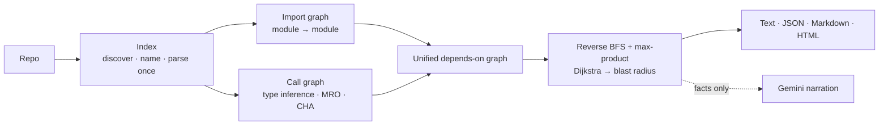

# PyImpact

[](https://github.com/abishek1123/pyimpact/actions/workflows/ci.yml)
[](https://abishek1123.github.io/pyimpact/)
[](pyproject.toml)
[](LICENSE)

**What breaks if I change this?** PyImpact answers that for Python code with static
analysis. It parses a repository into an explicit dependency graph — every import,
call, constructor, subclass and override — and traces the *blast radius* of a change:
each function, class, file and test that depends on it, ranked by risk.

**[Try it in your browser →](https://abishek1123.github.io/pyimpact/)** Paste any public
GitHub repo. The real engine runs client-side via Pyodide; nothing is uploaded.

```text
$ pyimpact analyze . -t requests.sessions.Session.send
Analyzed 36 files, 599 functions in 0.5s
Target: requests.sessions:Session.send (src/requests/sessions.py:673)
Blast radius: 191 components (51 high, 98 medium, 42 low)
-- 1 hop away --
  HIGH   [method  ] requests.sessions:Session.request  src/requests/sessions.py:500  (calls Session.send)
  HIGH   [method  ] tests.test_requests:TestRequests.test_prepared_from_session  tests/test_requests.py:1173  (calls Session.send)
  ...
Tests to run (160):
  pytest tests/test_lowlevel.py tests/test_packages.py tests/test_requests.py tests/test_testserver.py
```

## Why it's different

Most "AI + your codebase" tools *search and summarize*. PyImpact does **deterministic
dependency tracing**: the graph is ground truth, so every result can be traced to a
concrete edge at a concrete line. The optional AI features only *narrate* what the
graph already found — the model is never asked what is affected, so it can't invent an
impact.

- **Built for review and CI.** `pyimpact diff` maps your branch's changes to the exact
  functions they touch, including **deleted code that something still calls**. A
  [GitHub Action](#github-action) posts the blast radius on every pull request.
- **Test selection.** Every report ends with the `pytest` command for the tests that
  exercise the change.
- **Honest about its limits.** When it can't resolve a call, it leaves the edge out
  rather than guessing ([details](#known-limitations)).

## Install

```bash
pip install "pyimpact-cli @ git+https://github.com/abishek1123/pyimpact"
pip install "pyimpact-cli[ai] @ git+https://github.com/abishek1123/pyimpact"   # + optional Gemini features
```

Python 3.10 or newer; the only runtime dependencies are `networkx` and `click`. The
command is `pyimpact`. Wheels are also attached to each
[GitHub release](https://github.com/abishek1123/pyimpact/releases).

## Usage

| Command | What it does |
|---|---|
| `pyimpact analyze [REPO] -t TARGET` | Everything that could break if `TARGET` changes |
| `pyimpact diff [REPO] [--base main]` | Blast radius of your uncommitted changes, or of a branch vs. its base |
| `pyimpact visualize [REPO] [-t TARGET \| --diff]` | Interactive HTML graph (blast radius, or the whole module architecture) |
| `pyimpact stats [REPO]` | Hotspots (where changes ripple furthest) and load-time import cycles |
| `pyimpact search [REPO] QUERY` | Find code by name or description (`--semantic` with Gemini) |
| `pyimpact summarize [REPO] -t TARGET` | AI summary grounded in the function's position in the graph |

`REPO` defaults to the current directory. Point it at a repository root: `src/` layouts,
namespace packages and monorepos are detected automatically.

**Targets** can be written several ways: `pkg.mod:func`, `pkg.mod.func`,
`pkg.mod.Class.method`, a class, a module (`pkg.mod`) or a file (`pkg/mod.py`). Repeat
`-t` to analyze several at once. A typo gets "did you mean" suggestions.

**Shared options:** `--format text|json|markdown`, `--output FILE`, `--exclude GLOB`
(repeatable), `--max-distance N`, `--min-severity high|medium|low`.

### Reviewing a change

```bash
pyimpact diff                       # working tree vs HEAD (untracked files included)
pyimpact diff --staged              # just what's staged
pyimpact diff --base origin/main    # this branch since it forked from main
pyimpact diff --base main --fail-on high   # exit 2 if anything high-risk is hit (CI gate)
```

`diff` reads changed line numbers from git and maps them onto the innermost function,
method or class in the current code. It also reads the base version of each file, so a
**removed or renamed** symbol is detected too. Its callers are found in a graph built from
the base revision, and the ones that still exist are reported as *still referencing removed
code*. Whitespace and comment-only edits at module level are ignored.

### More examples

```bash
pyimpact analyze -t app.billing.charge --explain     # + one-line AI "why" for the top risks
pyimpact visualize -t app.models.User --max-nodes 150
pyimpact visualize --diff --base main                # the PR, as a graph
pyimpact stats --top 20 -f json
pyimpact search "retry with exponential backoff"
pyimpact analyze -t app.core -f markdown -o impact.md
```

## GitHub Action

Post the blast radius of every pull request as a comment, updated in place on each push:

```yaml
# .github/workflows/impact.yml
name: Impact report
on: pull_request
permissions:
  contents: read
  pull-requests: write
jobs:
  impact:
    runs-on: ubuntu-latest
    steps:
      - uses: actions/checkout@v5
        with:
          fetch-depth: 0          # history is needed to find the merge-base
      - uses: abishek1123/pyimpact@v1
        with:
          fail-on: never          # or: breaking | high | medium | low
          exclude: "docs */migrations/*"
```

| Input | Default | |
|---|---|---|
| `path` | `.` | Directory to analyze |
| `base` | PR base branch | Ref to compare against |
| `comment` | `true` | Post/update the PR comment |
| `fail-on` | `never` | Fail the job at this level (`breaking` = removed code still referenced) |
| `max-items` | `40` | Rows in the report table |
| `exclude` | | Space-separated globs to skip |

The report is also written to the job summary. Outputs `affected`, `high`, `medium`,
`low`, `breaking`, `tests` and `report` (the Markdown path) are available to later steps.

## How it works



Every edge points from the dependent to the dependency, so "what does this change
affect?" is **reverse reachability**: everything that can reach the target. Each edge has
a confidence weight. A result's score is the product of the weights along its strongest
path, multiplied by 0.85 for each extra hop:

| Edge | Meaning | Weight |
|---|---|---|
| `call` (direct) | A calls B at a resolved call site | 1.00 |
| `instantiate` | A constructs class B | 0.90 |
| `call` (reference) | A passes B as a value: callback, decorator, `Thread(target=B)` | 0.85 |
| `inherits` | class A subclasses B | 0.80 |
| `uses` | A references class B: `isinstance`, annotations, `except B` | 0.70 |
| `call` (virtual) | B overrides the method A calls, so dynamic dispatch may reach it | 0.60 |
| `import` | module A imports module B | 0.50 |
| `member` | class A defines method B | 0.40 |
| `contains` | module A defines B | 1.00 |

Scores of **≥ 0.7 are high**, **≥ 0.35 medium**, and the rest low. So a direct or short
transitive caller is high, and a file that merely imports the module is medium. Code
that constructs a class whose *other* method changed is low.

**Name resolution.** Python is dynamically typed, so the call graph does a light,
flow-insensitive type inference:

- module symbols, including relative imports and re-exports through `__init__.py`
  (`from requests import Session`)
- `self`/`cls`, with inheritance (MRO) and `super()`; overrides in subclasses through
  class-hierarchy analysis
- local variables whose every assignment agrees: `x = Foo()`, `with Foo() as x`,
  walrus, `x = make()` when `make` is annotated `-> Foo`
- annotated parameters, including `Optional[Foo]`, `Foo | None` and `"Foo"`
- instance attributes assigned anywhere in a class (`self.db = Database()`), so
  `self.db.query()` resolves
- module-level instances (`app = Flask(__name__)`), and `getattr(obj, "literal")`
- `@overload` stubs: the real implementation is used
- code that runs at import time, such as `if __name__ == "__main__": main()`

**Hotspots** count, for every function, how many production functions transitively call
it. All of these counts are exact and computed at once, by propagating ancestor bitsets
through the condensation DAG. **Import cycles** only consider imports that run at load
time: `if TYPE_CHECKING:` imports and imports inside functions are excluded.

**Performance:** a single parse per file, single-pass scope scans, and statement-only
import extraction.

| Codebase | Files | Graph | Time |
|---|---|---|---|
| requests | 36 | 599 functions | 0.5 s |
| flask (with tests and examples) | 83 | 825 functions | 0.7 s |
| a virtualenv's `site-packages` | 2,682 | 37.6k nodes, 100k edges | ~45 s |

## AI features (optional)

Set `GEMINI_API_KEY` (or put `GEMINI_API_KEY=...` in a `.env` file) and install the
`ai` extra (or just `pip install google-genai numpy`). Free keys are available at <https://aistudio.google.com/apikey>.

- `--explain` on `analyze`/`diff` adds a one-sentence *why* for the highest-risk items.
  The model receives each item's edge, line number, source line and severity, and is
  told the impact is already decided.
- `summarize` describes a function using its graph position: who depends on it, what it
  depends on, and its blast radius. The size label (small, moderate or large) is computed
  deterministically, not by the model.
- `search --semantic` embeds each symbol's signature, docstring and source with
  `gemini-embedding-001`, caches vectors locally by content hash, and fuses the results
  with BM25 using reciprocal rank fusion.

The default model is `gemini-3.5-flash-lite`; change it with `--model` or
`GEMINI_MODEL`. Static analysis never needs a key.

## Python API

```python
from pyimpact.impact import build_unified_graph, find_impact, resolve_target
from pyimpact.diff import analyze_diff

graph = build_unified_graph("path/to/repo")
node = resolve_target(graph, "app.billing.charge")
for item in find_impact(graph, node):
    print(item.severity, item.node, item.distance, item.via)

result = analyze_diff("path/to/repo", base="main")
print([c.node for c in result.changed], len(result.affected), result.removed_affected)
```

## Known limitations

Static analysis of a dynamic language has hard limits. PyImpact prefers a **missing
edge over an invented one**:

- **Untyped values stay untyped.** `def f(obj): obj.save()` can't be resolved without
  an annotation or an assignment to follow. Values flowing through containers, `**kwargs`
  or return values without annotations are not tracked.
- **Dynamic dispatch by computed name** isn't followed: `getattr(obj, name)()`,
  dispatch dictionaries, `importlib`, monkey-patching and plugin registries.
- **Decorators that swap the function** are recorded as a dependency, but calls through
  the wrapper resolve to the original function.
- **`from module import *`** is not tracked, and nested functions are attributed to
  their enclosing function.
- **File-level import impact is an upper bound.** Importing a module doesn't mean using
  the changed function, which is why those results are medium or low.
- **Inference is flow-insensitive.** If a variable is assigned two different types,
  PyImpact deliberately gives up rather than picking one.

Each of these is pinned by a test, so the boundaries are deliberate.

## Development

```bash
git clone https://github.com/abishek1123/pyimpact && cd pyimpact
python -m venv venv && source venv/bin/activate     # Windows: venv\Scripts\activate
pip install -e ".[dev]"
python scripts/fetch_fixtures.py     # pinned requests/flask/click/bottle for integration tests
pytest                               # unit, git-level and integration tests
ruff check .
python scripts/build_site.py _site   # build the browser playground locally
```

The test suite has three layers:

- **Unit tests:** each pipeline stage is checked on hand-written repos where the right
  answer is obvious, including "must not resolve" cases.
- **Git-level tests:** `diff` is exercised against real temporary repositories.
- **Integration tests:** assertions against pinned releases of requests, flask, click
  and bottle that you can confirm by reading their source.

## License

[MIT](LICENSE)
